# Sova

Sova («Сова») is a personal build of [CrossPoint Reader](https://github.com/crosspoint-reader/crosspoint-reader) for the Xteink X4 Pro and X4.

<table>
  <tr>
    <td align="center">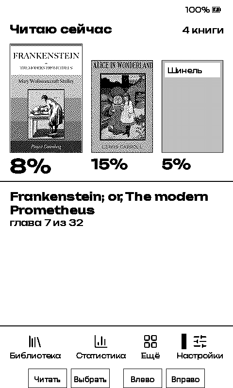<br><sub>Home (X4)</sub></td>
    <td align="center"><br><sub>Page in the book, time left (X4)</sub></td>
    <td align="center">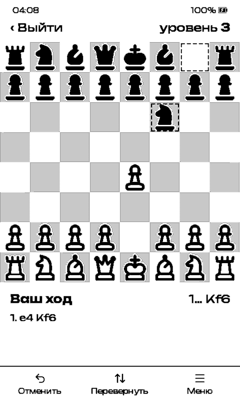<br><sub>Chess (X4 Pro)</sub></td>
    <td align="center">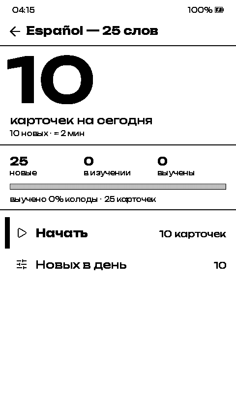<br><sub>Flashcards (X4 Pro)</sub></td>
  </tr>
</table>

Sova runs on two Xteink readers: the X4 Pro (ESP32-S3, touch, frontlight) and the plain X4 (ESP32-C3, buttons only); the X4 build also carries the X3 board profile. Upstream features are listed in the [CrossPoint README](https://github.com/crosspoint-reader/crosspoint-reader#what-can-crosspoint-do); this file covers what the fork adds. The screenshots come from the simulator running this build, with the Russian interface.

## Install

1. Download the file for your reader from the [latest release](https://github.com/alyapin/crosspoint-reader/releases/latest), currently [2.0.1](https://github.com/alyapin/crosspoint-reader/releases/tag/2.0.1):

   | Reader | File |
   | ------ | ---- |
   | X4 Pro | `crosspoint-2.0.1-x4pro.bin` |
   | X4, X3 | `crosspoint-2.0.1-x3-x4.bin` |

2. Copy it to the SD card. The picker lists any file ending in `.bin`, so you can rename it; a file built for another device is refused.
3. On the device, open Settings → System → SD Card Firmware Update, pick the file and confirm.
4. After the first boot, leave the device on for about 10 seconds or let it go to sleep before you press Reset. Until then the new firmware is not confirmed, and on the X4 Pro a reset returns to the previous one.

The SD card path needs CrossPoint or Sova on the device already. Otherwise flash over USB with the web flasher's Custom .bin option or with `esptool`, as described under [Install firmware](https://github.com/crosspoint-reader/crosspoint-reader#install-firmware) in the CrossPoint README.

Later updates can come over Wi-Fi: Settings → System → Check for Updates looks at the latest release of this repository and offers the file for your reader when its version is newer.

### Going back to the previous firmware

An SD card update keeps the previous firmware in a second slot. To restart into it, hold a button combo:

- X4 Pro: Left + Right. From sleep, hold both and press Power; after Reset, start holding them within about 1.5 seconds. Keep them held for 3 to 5 seconds. Never hold Left while pressing Reset or turning the device on from a full power-off: it is also the chip's boot-mode pin.
- X4 and X3: Back + Side Down. Hold both, then press Power or Reset, and keep them held for 3 to 5 seconds.

Three crashes in a row during start-up do the same on their own. The user guide has the details: [X4 Pro](./USER_GUIDE.md#going-back-to-the-previous-firmware-x4-pro), [X4 and X3](./USER_GUIDE.md#going-back-to-the-previous-firmware-x4-x3).

## What Sova adds

### Reading

<table>
  <tr>
    <td align="center">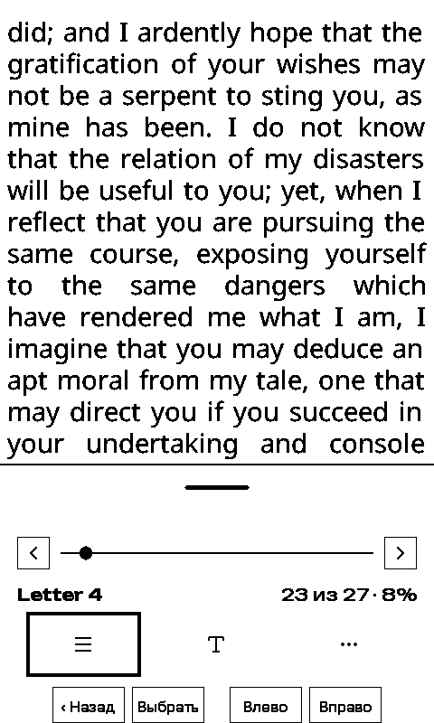<br><sub>Reader menu as a toolbar (X4)</sub></td>
    <td align="center">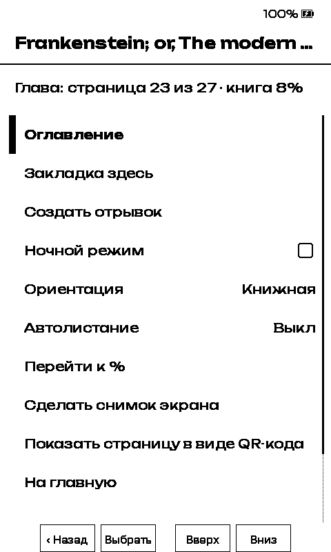<br><sub>Reader menu as a list (X4)</sub></td>
  </tr>
</table>

- Reader footer with the page number in the whole book and the reading time left. Pages not laid out yet are estimated and marked with `~`; reading speed is learned from your page turns.
- Battery in the reader footer: Settings → Reader → Customise Status Bar → Battery, off by default.
- FB2 and FB2.ZIP books, converted once into an EPUB inside the book's cache.
- A right-edge swipe sets the frontlight brightness while reading (X4 Pro, Edge Swipe Brightness setting).

### Library and statistics

<table>
  <tr>
    <td align="center">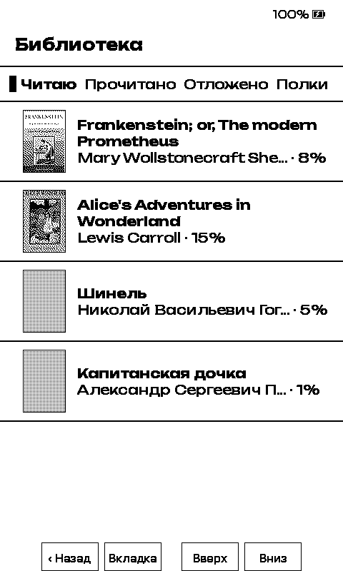<br><sub>Library tabs (X4)</sub></td>
    <td align="center">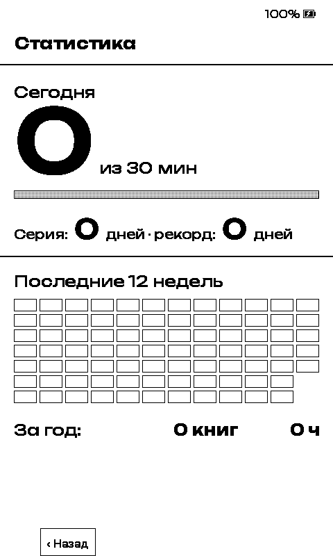<br><sub>Statistics (X4)</sub></td>
  </tr>
</table>

- Home shows the books you are reading and four tabs: Library, Statistics, More and Settings.
- Library tabs by status (Reading, Finished, Paused) and shelves you create, rename and delete.
- Reading statistics on a Home tab: today's minutes against a daily goal, streak and record, a 12-week calendar, books finished and hours read this year.

### Flashcards

<table>
  <tr>
    <td align="center">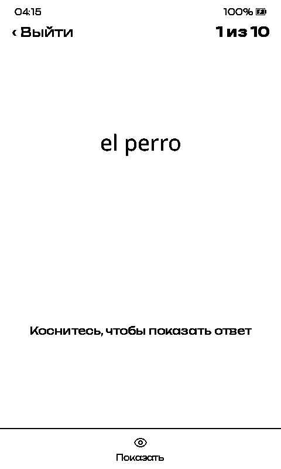<br><sub>Card front (X4 Pro)</sub></td>
    <td align="center">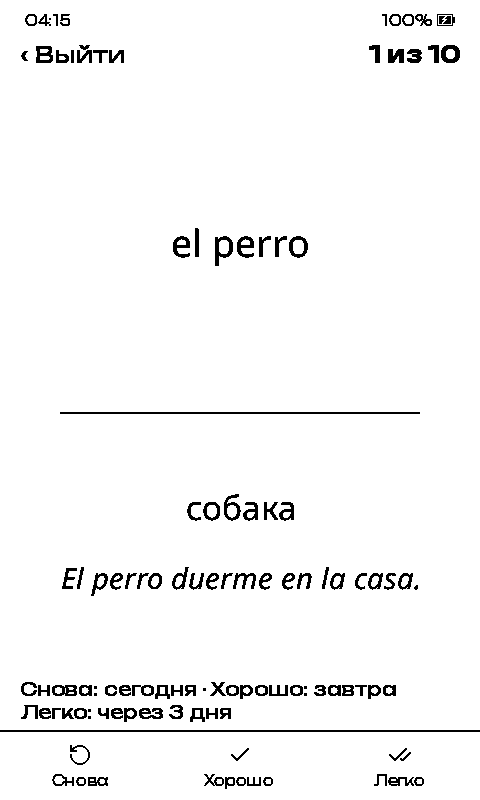<br><sub>Answer, graded Again, Good or Easy (X4 Pro)</sub></td>
  </tr>
</table>

Under More → Flashcards:

- Leitner decks in `/Карточки` on the card, copied there or sent over LocalSend: `.tsv`, `.csv` and Anki's «Notes in Plain Text» export (`.txt`), including Anki cloze notes. Depending on its box, a card comes back after 1 to 120 days.
- Each answer is graded Again, Good or Easy; on the X4 that is Left, Confirm and Right, and holding Back undoes the last answer.

### Getting books (LocalSend)

- Receive books over LocalSend: More → Receive books shows the device as «Сова» with a 4-digit code, and you accept or decline each transfer. Books go to `/Книги` (or the OPDS download folder, if one is set), flashcard decks to `/Карточки`. The receiver runs only while that screen is open.

### Games

<table>
  <tr>
    <td align="center">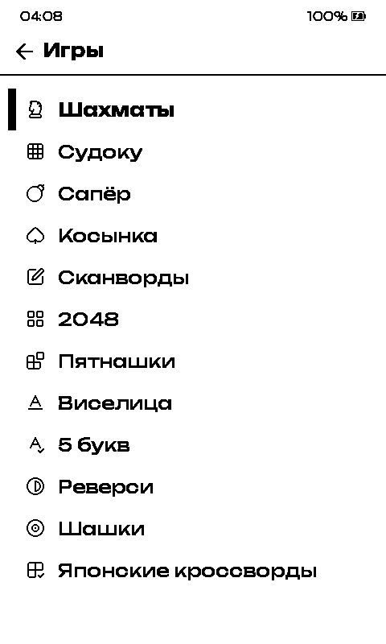<br><sub>12 games (X4 Pro)</sub></td>
    <td align="center">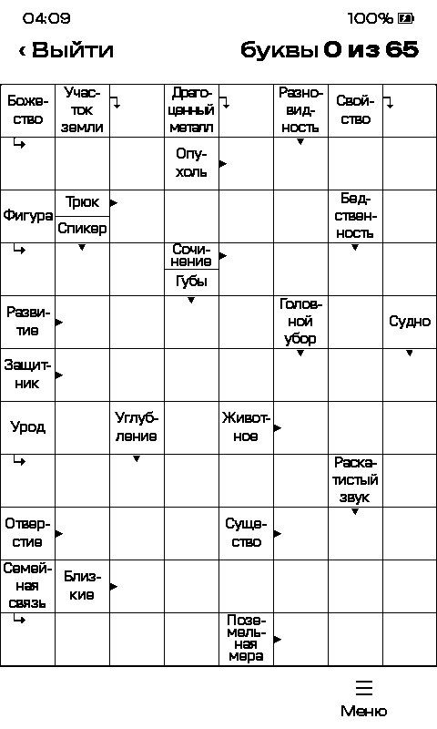<br><sub>Scanwords (X4 Pro)</sub></td>
    <td align="center">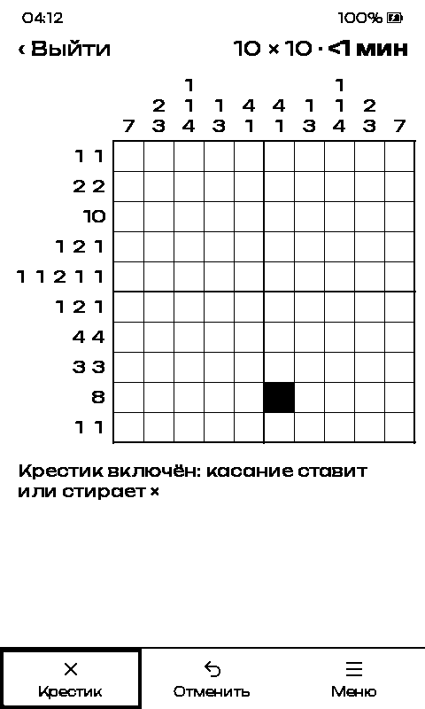<br><sub>Nonograms (X4 Pro)</sub></td>
  </tr>
  <tr>
    <td align="center">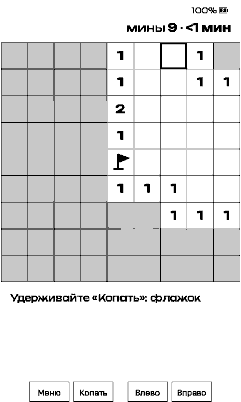<br><sub>Minesweeper on buttons: hold Confirm to flag (X4)</sub></td>
    <td align="center">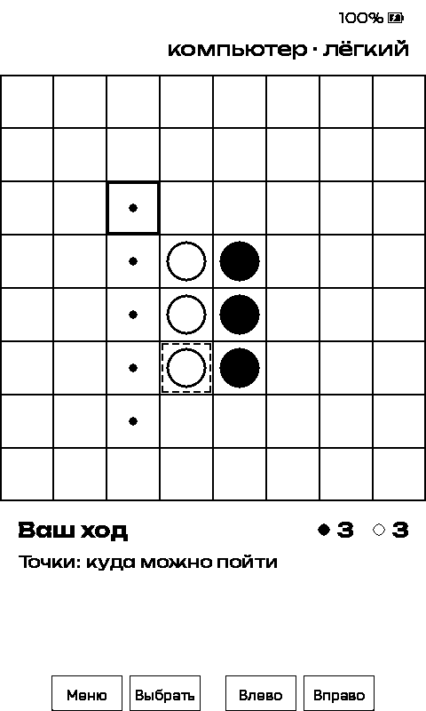<br><sub>Reversi against the computer (X4)</sub></td>
    <td></td>
  </tr>
</table>

Under More → Games, with touch on the X4 Pro and buttons on the X4, saved to the SD card. The X4 Pro has 12, the X4 has 9:

- Chess against the computer (levels 1 to 5) or a friend, with clocks and four piece sets.
- Sudoku, Minesweeper and Klondike solitaire.
- Scanwords, from puzzle files in `/scanwords/` on the card (see [Data packs](#data-packs)); without that folder the game has no puzzles.
- 2048 and the 15 puzzle.
- Hangman and 5 letters (a Russian Wordle) on built-in word lists; hangman has a separate mode with strong language.
- Reversi and Russian draughts, against the computer (three levels) or a second player.
- Nonograms, 10 × 10 and 15 × 15: random puzzles made on the device, and pictures read from `/nonograms/` on the card.
- The X4 build leaves out the keyboard games (scanwords, hangman, 5 letters): they take too many key presses.
- On the X4 the games run on the buttons: Back pauses a game and opens its menu, a held direction button repeats its step, and a held Confirm flags a cell in Minesweeper or draws a line in Nonograms.

### Sleep screen

<table>
  <tr>
    <td align="center">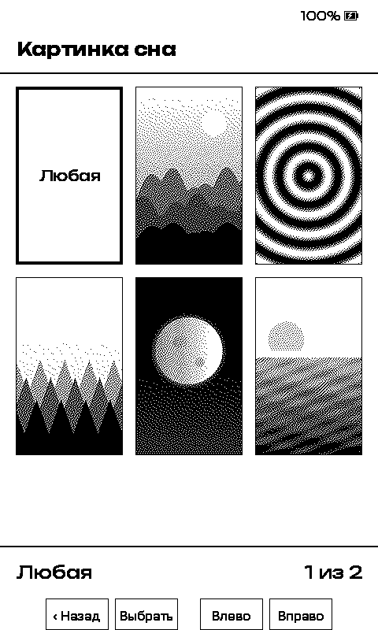<br><sub>Sleep image picker (X4)</sub></td>
  </tr>
</table>

- An owl on the boot screen and on the built-in Dark and Light sleep screens.
- Sleep image picker: Settings → Display → Sleep image shows a thumbnail grid of the BMPs in `/sleep` and `/.sleep`, with a full-screen preview. The first tile, Random («Любая» in Russian), goes back to a random picture.

### Design

- Setka, a 1-bit UI style for the screens the fork adds, drawn in Unbounded on both devices. The rules are in [.claude/skills/ui-style/SKILL.md](./.claude/skills/ui-style/SKILL.md).

### Battery and safety

- Light sleep between inputs on the X4 Pro: when idle, the chip sleeps until a button, a touch or the next timer wakes it, instead of polling every 10 ms.
- OTA rollback guard on the X4 Pro: a new firmware is confirmed only after about 10 seconds of running, or when the device goes to sleep, so a build that crashes during start-up returns to the previous one.

## Data packs

Two games read puzzles from folders in the root of the SD card. Neither ships in the firmware.

| Folder | Holds | How to make it |
| ------ | ----- | -------------- |
| `/scanwords/` | `index.txt` and one `.scw` file per puzzle | Copy [`tools/scanword/samples`](./tools/scanword/samples) (three puzzles) to `/scanwords/`, or build a pack: `tools/scanword/lexicon.py` makes a word list from a Russian Wiktionary dump and `tools/scanword/generator.py` writes the puzzles. |
| `/nonograms/` | `pictures.txt` | `tools/nonogram/generator.py` checks the pictures in `tools/nonogram/pictures.txt` and writes the `nonograms` folder to copy to the card. Random nonograms need no files. |

## Credits and licences

- [FreeInk SDK](https://github.com/Free-Ink/freeink-sdk) (the `freeink-sdk` submodule), MIT.
- Lucide icons, ISC, shipped in the FreeInk SDK.
- Chess pieces: Lucide, Tabler Icons (MIT), Material Design Icons by Pictogrammers (Apache 2.0) and Font Awesome Free (CC BY 4.0). Licence files are in `src/games/chess/ui/pieces/`.
- Code adapted from guloff/folio-firmware (MIT): the FB2 converter, the sleep image picker, the reading session model and the OTA rollback guard.
- LocalSend HTTP code ported from [bigbag/papyrix-reader](https://github.com/bigbag/papyrix-reader), MIT.
- Fonts in `lib/EpdFont/builtinFonts/source/`: Unbounded, Golos Text, Noto Sans, Noto Serif, Noto Sans Arabic, Noto Sans Hebrew and OpenDyslexic under the SIL Open Font License 1.1; Ubuntu under the Ubuntu Font Licence 1.0.
- Scanword clues and answers are derived from the Russian Wiktionary (CC BY-SA 4.0), ranked with wordfreq (CC BY-SA 4.0) and pymorphy3 / OpenCorpora data. The puzzles are shared under CC BY-SA 4.0; see `tools/scanword/samples/ATTRIBUTION.txt`. The hangman and 5 letters word lists come from the same sources; see `tools/hangman/ATTRIBUTION.txt` and `tools/five-letters/ATTRIBUTION.txt`.
- The random nonograms follow the generator of Pattern from Simon Tatham's Portable Puzzle Collection (MIT). The nonogram pictures were drawn for Sova and are MIT-licensed; see `tools/nonogram/ATTRIBUTION.txt`.

The firmware is MIT-licensed; see [LICENSE](./LICENSE).

## Building from source

Clone with submodules (`git submodule update --init --recursive` if you cloned without them) and install pioarduino core 6.1.19 into `.venv` as described in [Getting started](./docs/contributing/getting-started.md). The `freeink-sdk` submodule comes from [alyapin/freeink-sdk](https://github.com/alyapin/freeink-sdk), branch `sova`.

X4 Pro:

```sh
pio run -e x4pro-gh_release
```

The firmware lands in `.pio/build/x4pro-gh_release/firmware.bin`.

X4 and X3 use `gh_release`, built into `.pio/build/gh_release/firmware.bin`. Like every env with `custom_sdkconfig`, it builds a nested core environment, and that environment pulls pioarduino 6.2.x unless you pin it. 6.2.x installs SCons 4.11.1, the platform then deletes `tool-scons` in the middle of the build, and the link fails with `No module named 'SCons.Tool.FortranCommon'`. Build it in its own PlatformIO core directory, with the nested core pinned to 6.1.19:

```sh
export PLATFORMIO_CORE_DIR="$HOME/.platformio-c3"
python -m pip install uv
pio pkg install -e gh_release
uv pip install --python "$PLATFORMIO_CORE_DIR/penv/bin/python" 'pioarduino==6.1.19'
pio run -e gh_release
```

The separate core directory also keeps the C3 build from deleting the `tool-scons` package that X4 Pro builds in the default core use.

Host tests (GoogleTest through CMake and CTest, needs `cmake`):

```sh
pio run -t unit-tests
```

Simulator: the `simulator` and `simulator_x4_pro` envs are not in the repo. They go into an untracked `platformio.local.ini`, copied from crosspoint-simulator's `sample-platformio-macos.ini`. The ui-style skill has the commands for scripted taps and screenshots.

More developer docs: [contributing](./docs/contributing/README.md), [touch and UI development](./docs/contributing/touch-and-ui.md), [web server](./docs/webserver.md), [file formats](./docs/file-formats.md).

## User guide

How to use the device is in the [user guide](./USER_GUIDE.md). Its section [8. Sova features](./USER_GUIDE.md#8-sova-features) covers the screens above.

## Upstream

Sova is built on [CrossPoint Reader](https://github.com/crosspoint-reader/crosspoint-reader) and the work of its contributors, MIT. See [crosspointreader.com](https://crosspointreader.com), and you can [fund CrossPoint contributors](https://app.royalty.dev/crosspoint-reader/crosspoint-reader).

Sova and CrossPoint Reader are not affiliated with Xteink or any device manufacturer.
